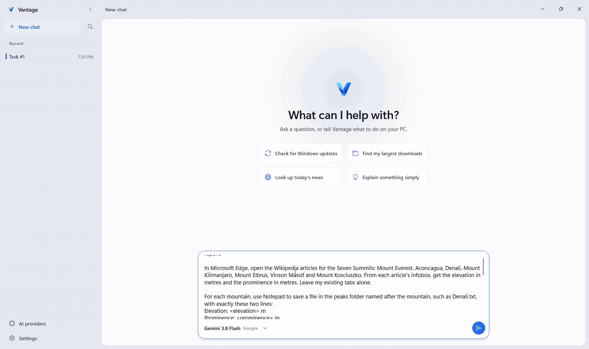

# Vantage

Vantage is a native Windows 11 chat app for an AI assistant that can work with your desktop. It supports screenshots, mouse and keyboard input, Windows UI Automation, apps, windows, clipboard, and PowerShell.

History, settings, provider configuration, and task state are stored locally under `%LOCALAPPDATA%\Vantage`. API keys are protected with Windows DPAPI.

## Demo

[](https://github.com/HappyGamerGoose/Vantage/releases/download/v1.6/Vantage-1.6-demo.mp4)

Vantage with Gemini 3.8 Flash as its model, given the prompt below and nothing else. It finished in 80 steps and about 8 minutes, shown here 12 times faster. [Watch the full run](https://github.com/HappyGamerGoose/Vantage/releases/download/v1.6/Vantage-1.6-demo.mp4) (10 minutes, 6 MB).

It opened the seven articles in a new Edge window, read each figure from the infobox, converted the elevations in Calculator's Length converter, wrote every file in Notepad and read the system details from Settings. The step that restores files from an earlier test was skipped: that folder, Vantage Final Test, was not on the desktop, so there was no raw.zip to extract.

<details>
<summary>The prompt</summary>

```text
On my Desktop, create a folder called Vantage Summit Test containing three folders named peaks, restored and report.

In Microsoft Edge, open the Wikipedia articles for the Seven Summits: Mount Everest, Aconcagua, Denali, Mount Kilimanjaro, Mount Elbrus, Vinson Massif and Mount Kosciuszko. From each article's infobox, get the elevation in metres and the prominence in metres. Leave my existing tabs alone.

For each mountain, use Notepad to save a file in the peaks folder named after the mountain, such as Denali.txt, with exactly these two lines:
Elevation: <elevation> m
Prominence: <prominence> m

Use the Length converter in the Windows Calculator app, not its Standard mode, to convert each elevation from metres to feet, rounded to 1 decimal place.

Open Settings and, without changing anything, find the display resolution under System, then Display, and the processor and installed RAM under System, then About.

Use File Explorer, not PowerShell, to extract raw.zip from the report folder inside Vantage Final Test on my Desktop into the restored folder. Open the extracted Canada.txt in Notepad, use Notepad's Replace to change Capital: to Capital city:, and save the result next to it as Canada-edited.txt. Canada.txt itself must stay unchanged.

In the report folder, create summary.txt containing one line per mountain, highest elevation first, in this form:
<mountain> | <elevation> m | <feet> ft | <prominence> m
After those lines, add a blank line, then these five lines:
Highest: <mountain>
Average elevation: <average of the seven elevations, rounded to 1 decimal place> m
Display: <resolution>
Processor: <processor>
RAM: <installed RAM>
If you cannot confirm a value, write UNCONFIRMED in its place instead of guessing.

Close Notepad, Calculator and Settings. In Edge, close the seven Wikipedia tabs you opened and no others. Then open the Vantage Summit Test folder in File Explorer and leave it open.
```

</details>

<details>
<summary>The summary.txt it wrote</summary>

```text
Mount Everest | 8,848.86 m | 29031.7 ft | 8,848.86 m
Aconcagua | 6,967.16 m | 22858.1 ft | 6,967.16 m
Denali | 6,190 m | 20308.4 ft | 6,144 m
Mount Kilimanjaro | 5,895 m | 19340.6 ft | 5,895 m
Mount Elbrus | 5,642 m | 18510.5 ft | 4,741 m
Vinson Massif | 4,892 m | 16049.9 ft | 4,892 m
Mount Kosciuszko | 2,228 m | 7309.7 ft | 2,228 m

Highest: Mount Everest
Average elevation: 5809.0 m
Display: 1920 × 1200
Processor: 13th Gen Intel(R) Core(TM) i9-13900H
RAM: 24.0 GB
```

</details>

## Requirements

- Windows 11, or Windows 10 build 22000 or later
- .NET 9 SDK
- Windows SDK 10.0.26100

## Build

```powershell
dotnet restore
dotnet build .\src\Vantage.csproj --configuration Release --no-restore -p:Platform=x64 -p:RuntimeIdentifier=win-x64
```

## Package

Create a self-contained VeloPack installer:

```powershell
.\scripts\pack-velopack.ps1
```

The installer and update packages are written to `releases\velopack`. The files to attach to a GitHub release are copied to `releases\github\<version>`, with an update list that names only that version.

## Run

```powershell
.\releases\velopack\HappyGamerGoose.Vantage-win-Setup.exe
```

Open Settings, add a provider, and enter a request in the chat box.

## Computer Use

Use `batch` for short sequences that do not need a new screenshot between steps. Use window-scoped actions when accessibility information is available. Refresh observations after an action changes focus or layout.

The app can send computer-use input and run requested PowerShell commands without per-action approval dialogs. Use only providers and instructions you trust. Stop or press Escape to cancel an active run.

## Tests

```powershell
$probe = ".\src\probe-worldstate\probe-worldstate.csproj"
dotnet run --project $probe -- --input-self-test
dotnet run --project $probe -- --context-self-test
dotnet run --project $probe -- --launch-match-self-test
dotnet run --project $probe -- --powershell-self-test
dotnet run --project $probe -- --computer-use-prompt-self-test
dotnet run --project $probe -- --reasoning-self-test
dotnet run --project $probe -- --flow-self-test
dotnet run --project $probe -- --provider-models-self-test
dotnet run --project $probe -- --agent-accuracy-self-test
dotnet run --project $probe -- --agent-speed-self-test
dotnet run --project $probe -- --agent-loop-self-test
dotnet run --project $probe -- --model-name-self-test
dotnet run --project $probe -- --computer-use-self-test
```

## License

[MIT](LICENSE)
